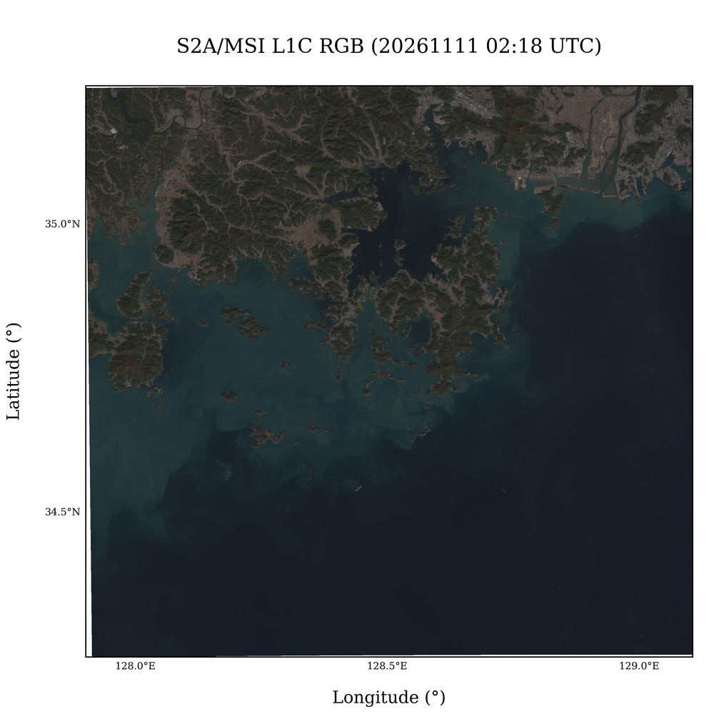
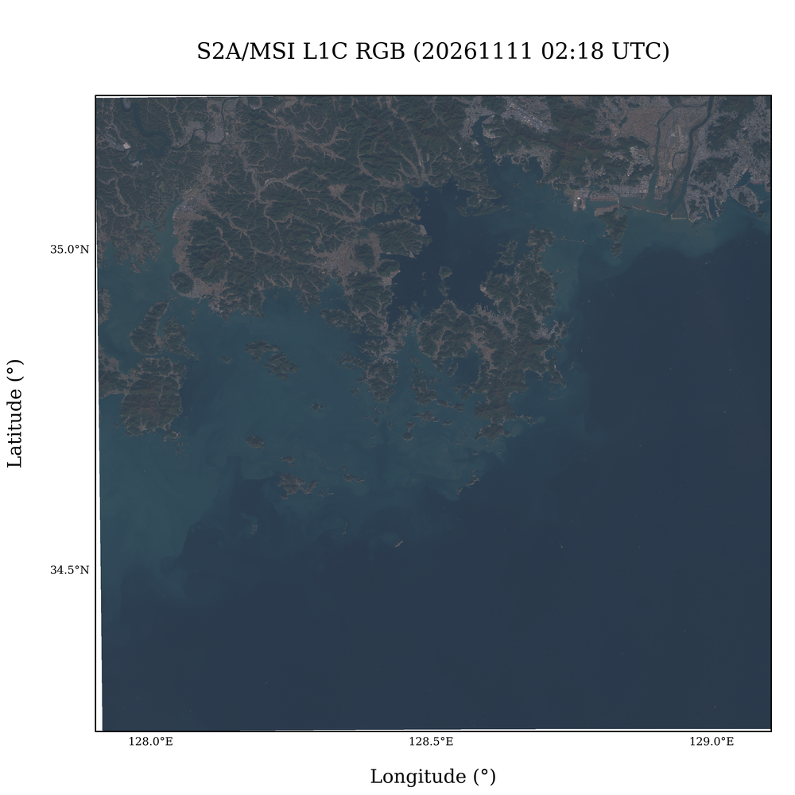
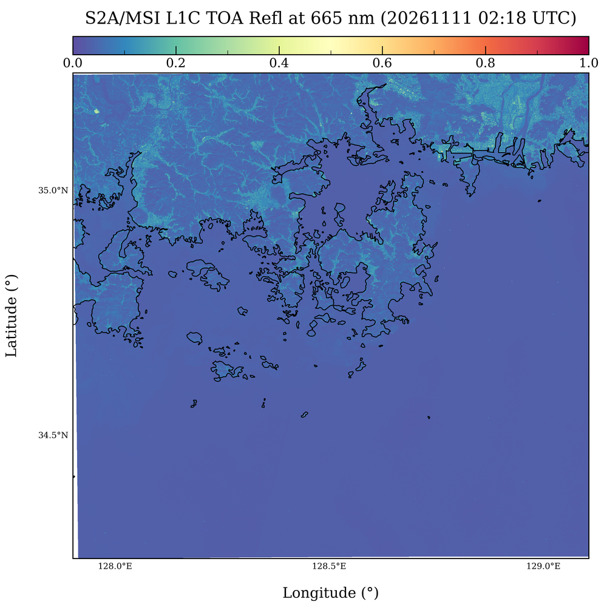

# S2_CalAC

IDL + Python tools that read **Sentinel-2 MSI Level-1C** products, compute **TOA reflectance and per-pixel sun/view geometry**, and produce research-grade quick-look maps.
This started as a basic data-handling codebase for practicing **L1 radiometric calibration** and **L2 atmospheric correction** of Sentinel-2.

- Data reading & physics: **IDL**
- Map rendering: **Python (matplotlib + cartopy)**, called from IDL via the **IDL-Python Bridge**

<p align="center">
  
</p>

---

## Features

- **L1C metadata parsing** (`MTD_MSIL1C.xml`, `MTD_TL.xml`)
  - Spacecraft (S2A/S2B/S2C), sensing time (UTC), UTM zone, band wavelengths (min / central / max)
- **Geolocation**: tile UTM pixel-center coordinates → latitude/longitude on the 10 m grid
- **Sun/view geometry** at 10 m pixel level
  - SZA, SAA: 5 km angle grids interpolated to 10 m
  - VZA, VAA: each pixel takes the angle of the detector that actually observed it, using the detector footprint masks (`MSK_DETFOO_Bxx.jp2`).
    Empty nodes in each detector grid are filled by a plane fit before interpolation.
  - RAA = |SAA − VAA|, folded to 0–180°
- **TOA reflectance**
  - `ρ_TOA = (DN + RADIO_ADD_OFFSET) / QUANTIFICATION_VALUE`
  - DN = 0 is treated as NoData (NaN). 20 m and 60 m bands are resampled to the 10 m grid.
- **Rayleigh correction (optional)**: Rayleigh optical depth from Bodhaine et al. (1999) with a single-scattering approximation
  - `ρ_ray = τ_R · P_R(Θ) / (4 μ0 μ)`
- **Visualization**
  - Single-band TOA reflectance map with a top colorbar
  - True-color RGB map (B04/B03/B02, gamma 0.5)
  - Lon/lat tick spacing and decimal places chosen automatically from the map extent
  - Optional GADM country boundaries

---

## Example Outputs

Sentinel-2A, 2026-11-11 02:18 UTC, tile T52SDD (South Coast of Korea)

| RGB (TOA) | RGB (Rayleigh-corrected) |
|:---:|:---:|
|  |  |

| TOA reflectance at 665 nm (B04) |
|:---:|
|  |

---

## Repository Structure

```
S2_CalAC/
├── source/
│   ├── read_s2_l1c.pro      # L1C reader: metadata, lat/lon, angles, TOA reflectance
│   ├── map_s2_l1c_ref.pro   # Main: single-band TOA reflectance map
│   ├── map_s2_l1c_rgb.pro   # Main: RGB map (+ optional Rayleigh correction)
│   ├── map_utils.py         # Single-parameter map renderer (draw_map)
│   └── map_rgb.py           # RGB map renderer (draw_rgb_map)
├── docs/images/             # Images used in this README
├── data/                    # Input data (not tracked)
│   ├── S2_L1C/              # *.SAFE (unzipped L1C products)
│   └── GADM/                # gadm41_<ISO>_shp/ (country boundaries, optional)
├── output/                  # Generated maps (not tracked)
│   ├── RGB/
│   └── TOA_Refl/
└── COPE-GSEG-EOPG-TN-15-0007 - Sentinel-2 Spectral Response Functions 2024 - 4.0.xlsx
```

---

## Requirements

| Item | Requirement |
|---|---|
| IDL | 8.5 or later (uses the IDL-Python Bridge, `XML_PARSE`, `IDLffJPEG2000`) |
| Python | 3.x, linked to the IDL-Python Bridge |
| Python packages | `numpy`, `matplotlib`, `cartopy` |

```bash
pip install numpy matplotlib cartopy
```

---

## Input Data

1. **Sentinel-2 L1C**
   Download from the [Copernicus Data Space Ecosystem](https://dataspace.copernicus.eu/) and place the **unzipped `.SAFE` folders** under `data/S2_L1C/`.
   ```bash
   cd data/S2_L1C
   unzip S2A_MSIL1C_20261111T021111_N0513_R103_T52SDD_20261111T040927.SAFE.zip
   ```
2. **GADM boundaries (optional)**
   Put [GADM 4.1](https://gadm.org/) shapefiles in `data/GADM/gadm41_<ISO>_shp/`.
   The code looks for KOR, JPN, PRK, CHN, RUS and TWN and draws whichever exist.
3. **Spectral response functions (reference)**
   `COPE-GSEG-EOPG-TN-15-0007 ... 4.0.xlsx` is the official ESA MSI SRF file for S2A, S2B and S2C.
   Source: [SentiWiki – S2 Documents](https://sentiwiki.copernicus.eu/web/s2-documents)

---

## Usage

### 1. Set paths, date and region

Edit the top of `map_s2_l1c_ref.pro` and `map_s2_l1c_rgb.pro`:

```idl
home_dir  = '/home/<user>/S2_CalAC/'

yyyy = 2026 & mm = 11 & dd = 11
tile_id = '52SDD'

lat_range = [34.249, 35.242]
lon_range = [127.901, 129.106]
```

On the Python side, set the GADM path with `GADM_ROOT` in `map_utils.py` and `map_rgb.py`.

### 2. Run

```idl
IDL> .r read_s2_l1c
IDL> map_s2_l1c_rgb     ; RGB map
IDL> map_s2_l1c_ref     ; single-band TOA reflectance map
```

### 3. Options

| File | Variable | Description |
|---|---|---|
| `map_s2_l1c_rgb.pro` | `do_Ray_cor = 'T'/'F'` | Apply Rayleigh correction (`'T'` adds `_rc` to the file name) |
| `map_s2_l1c_*.pro` | `BANDS=[...]` | Band indices to read: B01=0, B02=1, …, B8A=8, …, B12=12 |
| `map_rgb.py` | `GAMMA` | RGB gamma stretch (default 0.5) |
| `map_rgb.py` | `SHOW_BOUNDARIES` | Draw country boundaries on the RGB map |

### `read_s2_l1c` outputs

```idl
read_s2_l1c, data_dir, sat_type, date, yyyy, mm, dd, time, hh, mi, ss, $
             lat, lon, sza, saa, vza, vaa, raa, toa_refls, $
             minwl, maxwl, cwl, BANDS=[1, 2, 3]
```

| Variable | Dimensions | Description |
|---|---|---|
| `lat`, `lon` | [nx, ny] | Latitude/longitude of 10 m pixel centers |
| `sza`, `saa` | [nx, ny] | Solar zenith / azimuth angle (°) |
| `vza`, `vaa`, `raa` | [nx, ny, n_band] | Viewing zenith / azimuth angle and relative azimuth angle (°) |
| `toa_refls` | [nx, ny, n_band] | TOA reflectance, in the order given by `BANDS` |
| `minwl`, `maxwl`, `cwl` | [n_band] | Band wavelengths (nm) |

---

## Outputs

File naming: `YYYYMMDD_HHMMSS_S2<A|B|C>_MSI_L1C_<product>.png` (300 dpi)

| Product | Example |
|---|---|
| RGB | `output/RGB/20261111_021801_S2A_MSI_L1C_RGB.png` |
| RGB (Rayleigh-corrected) | `output/RGB/20261111_021801_S2A_MSI_L1C_RGB_rc.png` |
| TOA reflectance | `output/TOA_Refl/20261111_021801_S2A_MSI_L1C_TOA_Refl_665nm.png` |

---

## Roadmap

- [ ] L1 radiometric calibration: SRF-based band integration, cross-calibration
- [ ] L2 atmospheric correction: gas absorption and aerosol correction, coupling with a multiple-scattering RTM
- [ ] Multi-tile mosaicking

---

## References

- Bodhaine, B. A., Wood, N. B., Dutton, E. G., & Slusser, J. R. (1999). On Rayleigh optical depth calculations. *Journal of Atmospheric and Oceanic Technology*, 16(11), 1854–1861.
- ESA (2024). *Sentinel-2 Spectral Response Functions (S2-SRF)*, COPE-GSEG-EOPG-TN-15-0007, Issue 4.0.
- ESA. *Sentinel-2 Products Specification Document* (L1C metadata structure).

---

## Author

**Mingyu Shin**
Pukyong National University · mingyu911@pukyong.ac.kr
